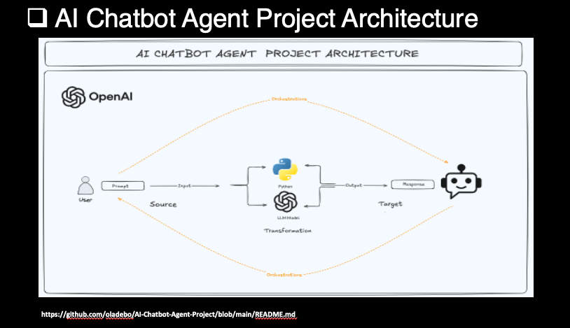

# AI-Chatbot-Agent-Project

## AI Chatbot Agent – Python & OpenAI LLM Integration

### Project Overview

This AI Chatbot Agent project demonstrates the development of an intelligent conversational assistant powered by Python and OpenAI Large Language Models (LLMs).

The solution uses Python to manage user inputs, orchestrate interactions with the LLM, process requests, and generate meaningful responses. OpenAI provides the intelligence layer that understands user prompts and generates contextually relevant answers.

The architecture establishes an end-to-end conversational workflow, connecting the user interface with the AI processing layer to deliver automated and interactive responses.

### Business Problem

Traditional chatbot systems often rely on predefined rules and static responses, making it difficult to understand complex user requests and provide flexible, context-aware answers.

Organizations need intelligent conversational solutions that can understand natural language, process user queries, automate responses, and improve customer interaction.

This project addresses these challenges by integrating Python with OpenAI LLM technology to build an AI-powered chatbot capable of processing prompts and generating intelligent responses.

### Project Objectives

- Develop an AI-powered conversational chatbot using Python and OpenAI.

- Integrate OpenAI Large Language Models for natural language understanding and response generation.

- Implement an orchestration workflow between users, Python, and the LLM.

- Transform user prompts into meaningful and contextually relevant responses.

- Automate conversational interactions and reduce manual response handling.

- Establish a scalable foundation for future AI agent development.

### Solution Architecture

#### The architecture consists of three major layers:

- 1. Source Layer – User Input

The user interacts with the chatbot by submitting a prompt or question.

The submitted prompt is captured and passed to the Python application for processing.

- 2. Transformation Layer – Python & OpenAI LLM

This is the core processing layer of the solution.

#### Python

- Receives and processes user prompts.

- Manages communication with the OpenAI LLM.

- Orchestrates the request and response workflow.

- Handles the transformation of input into output.

#### OpenAI LLM Model

- Understands natural language prompts.

- Interprets user requests.

- Generates intelligent and contextually relevant responses.

- Returns generated content to the Python application.

3. Target Layer – Chatbot Response

The processed response is returned through the chatbot interface.

The chatbot displays the generated answer to the user, completing the conversational workflow.

#### Technology Stack

| Technology | Purpose |
|------------|---------|
| Python | Application development and orchestration
| OpenAI API | Integration with the AI language model
| OpenAI LLM | Natural language understanding and response generation
| AI Agent Architecture | Managing conversational interactions

#### End-to-End Workflow

- User Interaction: The user submits a prompt through the chatbot.

- Input Processing: Python receives the submitted prompt.

- AI Orchestration: Python coordinates communication with the OpenAI LLM.

- LLM Processing: The language model interprets the request and generates a response.

- Response Transformation: Python receives and processes the generated output.

- Response Delivery: The chatbot displays the final response to the user.

- Continuous Interaction: The user can submit additional prompts and continue the conversation.

#### Key Features

- powered conversational interaction.

- Python-based application orchestration.

- OpenAI LLM integration.

- Natural language prompt processing.

- Automated response generation.

- End-to-end request and response management.

- Extensible architecture for future AI agent capabilities.

#### Expected Business Benefits

- Improved user interaction through natural language conversations.

- Reduced manual effort in handling repetitive queries.

- Faster response generation.

- Improved accessibility to information.

- Foundation for intelligent business process automation.

- Potential integration with enterprise data sources and business applications.

#### Future Enhancements

The architecture can be extended with additional AI agent capabilities, including:

- Conversation Memory: Retain relevant information from previous interactions.

- RAG (Retrieval-Augmented Generation): Connect the chatbot to enterprise documents and knowledge bases.

- Tool Calling: Enable the AI agent to interact with external APIs and business applications.

- Database Integration: Retrieve and process structured business information.

- Multi-Agent Architecture: Introduce specialized agents for different business tasks.

- Streamlit Interface: Build an interactive web-based chatbot application.

- Monitoring and Logging: Track chatbot interactions, errors, and performance.

### Project Conclusion

This project demonstrates how Python and OpenAI Large Language Models can work together to develop an intelligent conversational AI solution.

By implementing an end-to-end architecture covering user input, AI orchestration, LLM-based transformation, and automated response delivery, the project establishes a foundation for building more advanced AI-powered applications.

The solution also provides an opportunity to expand into enterprise AI applications, intelligent automation, Retrieval-Augmented Generation (RAG), and autonomous AI agents.

Project Category: Artificial Intelligence | Generative AI | AI Agent Development

Core Technologies: Python | OpenAI API | Large Language Models (LLMs)

